

  

<h1 align="center">freshly</h1>

  Spoil less, eat fresh: snap a receipt, swipe when food expires, and learn to waste less with friends.

  <a href="https://freshly.cooking/fridge"><b>Try it</b></a> ·
  <a href="https://devpost.com/software/freshly-m8zl9k"><b>Devpost</b></a> ·
  <a href="https://www.youtube.com/watch?v=BmtE5FegmVM"><b>Demo video</b></a> ·
  <a href="https://www.figma.com/deck/qz3jiYgXsa4t36d2Sec4CA"><b>Pitch deck</b></a> ·
  <a href="QUICKSTART.md"><b>Quickstart</b></a>

CalHacks Hackathon 2026 Submission.

---

## Demo

  

<table>
  <tr>
    <td align="center" width="33%">
      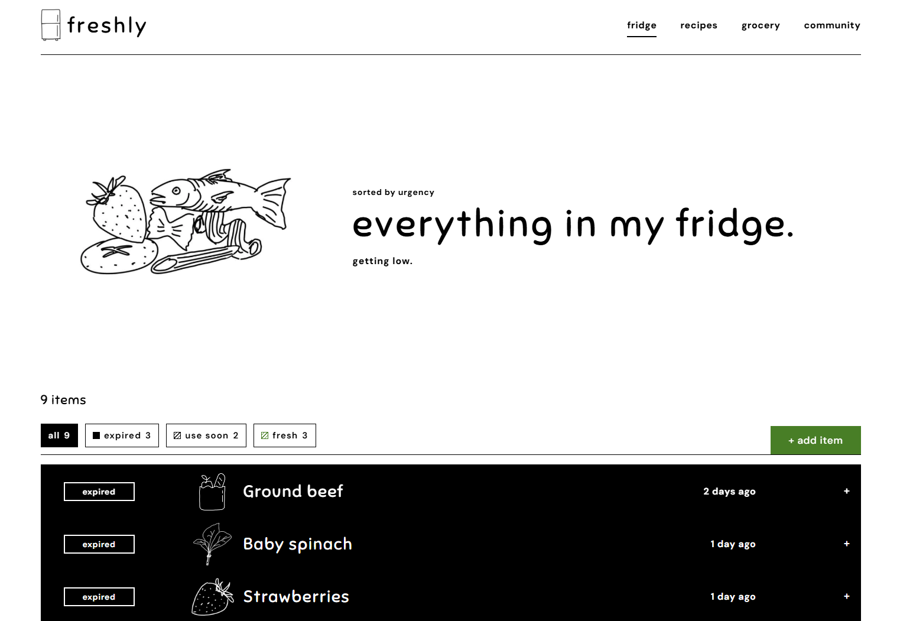
       <b>Everything in my fridge, sorted by urgency</b>
    </td>
    <td align="center" width="33%">
      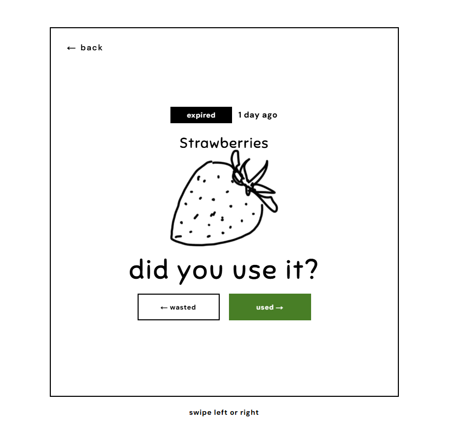
       <b>Swipe when food reaches its date</b>
    </td>
    <td align="center" width="33%">
      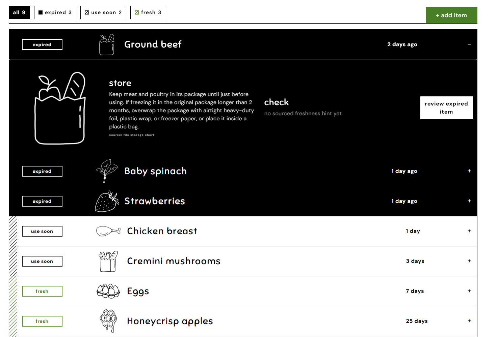
       <b>A second card only when it could still be good</b>
    </td>
  </tr>
  <tr>
    <td align="center">
      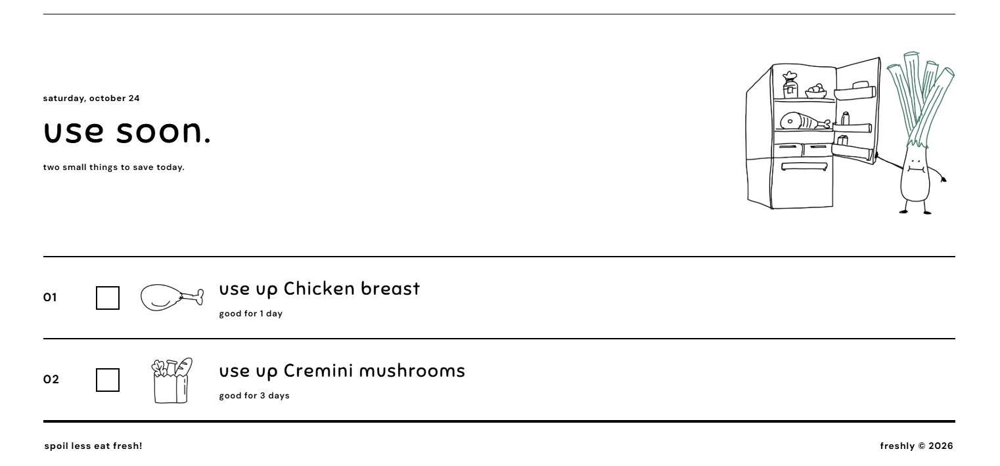
       <b>Recipes built around what expires first</b>
    </td>
    <td align="center">
      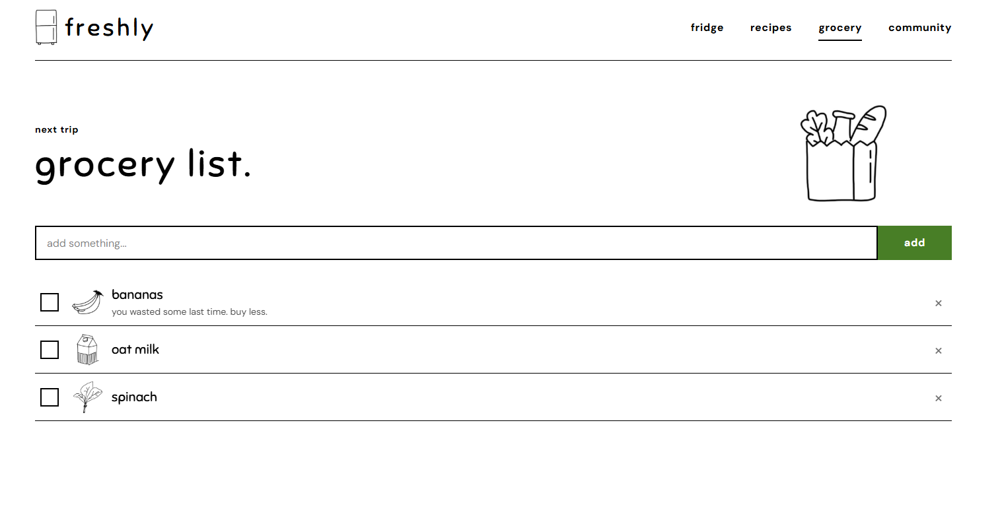
       <b>A grocery list that remembers what you wasted</b>
    </td>
    <td align="center">
      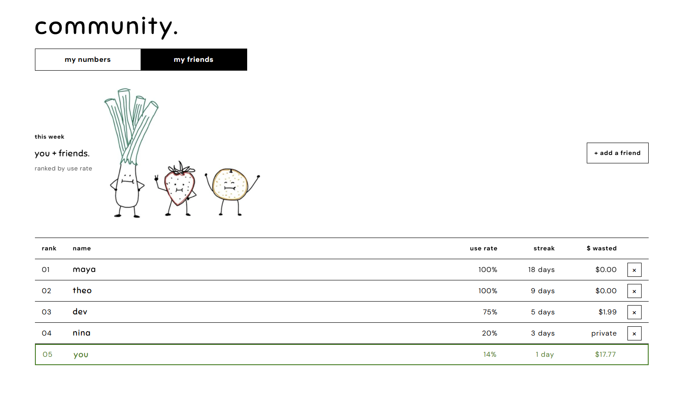
       <b>Waste less with friends</b>
    </td>
  </tr>
</table>

More screens

| | |
| --- | --- |
| 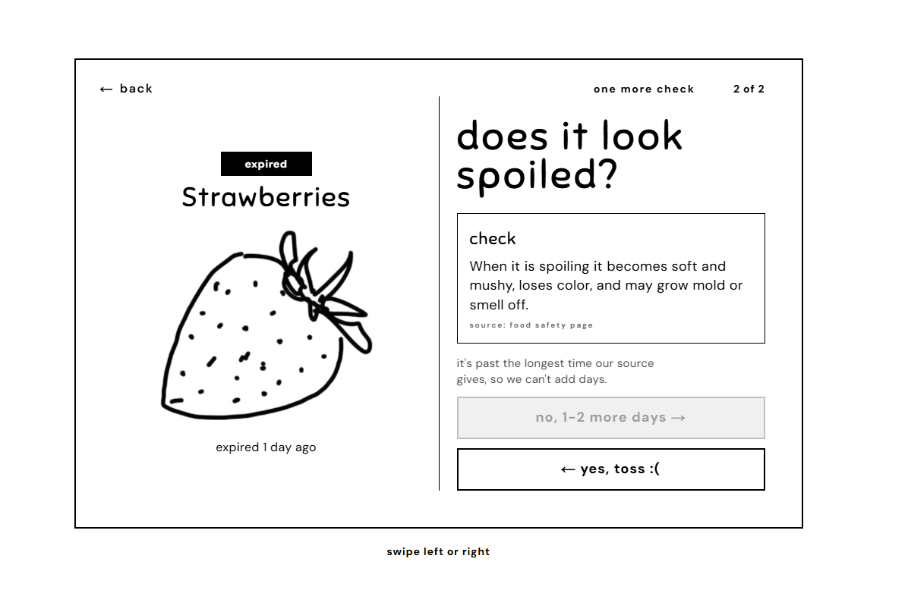 | 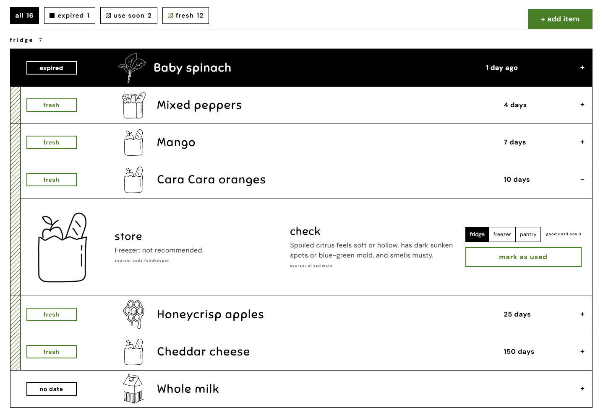 |
| Tossed food counts as half wasted | Storage tips for every food |
| 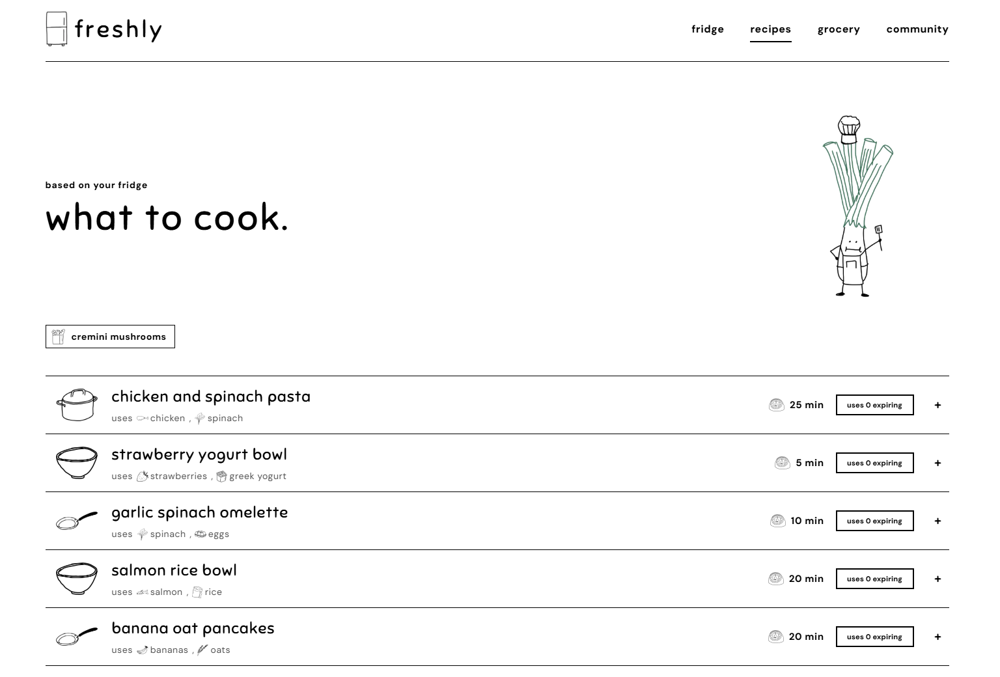 | 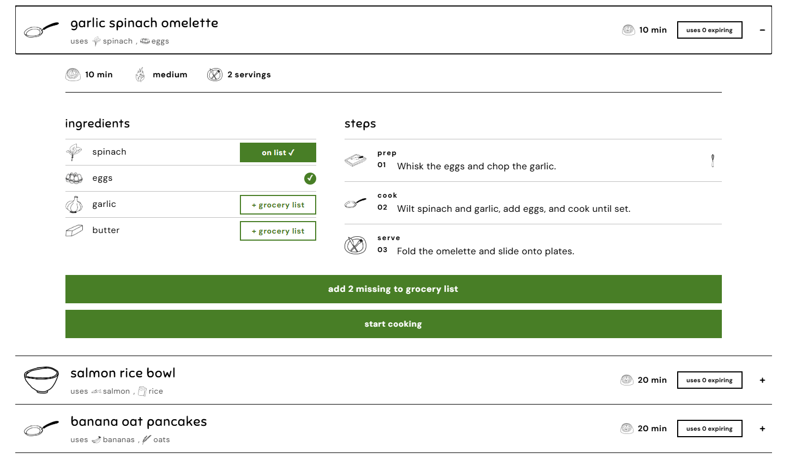 |
| Step-by-step recipe cards with timers | Missing ingredients go on the grocery list |
| 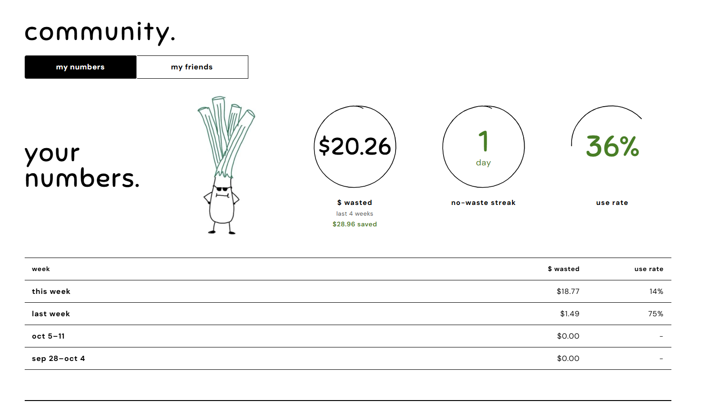 | |
| Dollars and pounds wasted, week over week | |

---

## Inspiration

You open the fridge, reach past the sauces, and find a bag of spinach that turned slimy days ago. You bought it for a specific recipe and forgot it was there.

That is how most food waste happens. Food gets buried, outlives a confusing date label, or comes in too big a size, and no one teaches us how to store it. We felt this most as college students: living alone for the first time, shopping on a tight budget, sharing a fridge, and juggling a schedule that makes it easy to forget what you bought. Anyone busy, cooking for one, or forgetful knows the feeling.

Smart fridges with cameras cost thousands of dollars, and cheaper tracking apps get abandoned within weeks because logging feels like a chore and constant notifications turn into noise. We wanted keeping food out of the trash to take one photo and a quick swipe, and we wanted wasting less to feel like a goal you share with friends.

## What it does

freshly has four tabs (fridge, recipes, grocery, and community) that run one loop:

- **Scan.** Snap a photo of your receipt. Claude turns every line, even cryptic ones like "96715 ORG SPINACH," into a food in your fridge, and Gemini double-checks the store, date, and total. Leftovers and takeout can be added by hand.
- **Estimate.** Each item is dated from a sourced shelf-life range: the FDA chart, then USDA FoodKeeper, then a trusted shelf-life page fetched with Apify. freshly uses the low end of the range, so food is often still good on its date. If no source has an answer, freshly asks for the date on the package instead of guessing.
- **See your fridge at a glance.** Items are sorted by expiry and tagged expired, use soon, or fresh, and the hand-drawn food pile grows and shrinks as you shop and eat.
- **Remind and swipe.** freshly checks your fridge once a day and sends one reminder covering every item with 7, 3, or 1 day left, and stays quiet on days with nothing coming up. When food reaches its date, swipe right if you used it and left if you didn't.
- **Cook what's expiring.** The recipes tab pulls real recipes from the web with Apify around the food you need to use first, and Gemini turns them into step-by-step cards with timers.
- **Shop smarter.** Grocery items carry notes from your history, like "you wasted some last time, buy less." Scan a receipt and matching items check themselves off.
- **Learn and compete.** Storage tips for every food, your own waste stats, and a weekly leaderboard with friends.

freshly gives quality estimates, never safety guarantees. When in doubt, throw it out.

## How it works

  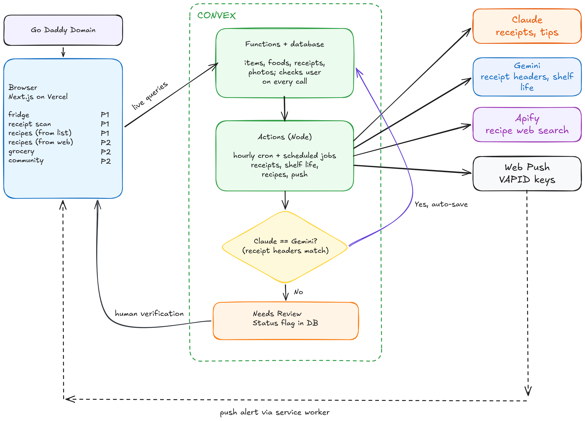

The Next.js app on Vercel talks to Convex over live queries, so every page updates when the data changes. Convex holds the database, the server functions, and an hourly cron that marks items expired and sends the daily reminder through Web Push. Outside calls run in Convex actions:

- **Claude** parses each receipt line and matches it to the food catalog.
- **Gemini** independently re-reads the receipt's store, date, and total. When the two models disagree, the receipt is flagged for you to review before anything enters your fridge.
- **Apify** searches the web for recipes and for shelf-life pages on packaged foods that the FDA and FoodKeeper don't cover.

Every shelf-life value in the food table links to the entry it came from. We merged the 2023 FDA fridge and freezer chart (55 foods, mostly eggs, meat, fish, deli, and leftovers) with USDA FoodKeeper (649 foods) for produce, dairy, and pantry goods. When both cover a food, the FDA value wins. Storage tips and freshness hints come from FoodKeeper first, then StillTasty pages fetched through Apify with the URL and a quoted sentence kept next to each one.

Waste stats can't be gamed. Items that expire unswiped count as wasted, tossed items count as half wasted, and every dollar and pound comes from what the food cost, how much it weighed, and how much you ate.

More detail: [docs/ARCHITECTURE.md](docs/ARCHITECTURE.md) traces each workflow function by function.

## Challenges we ran into

- **No database of exact expiry dates exists.** Knowing when a packaged item expires would take each product's manufacture date or every store's inventory and restock schedule, and none of that is public. We estimate from the most trusted shelf-life source for each food instead. Crowdsourcing ("when did this actually go bad?") could help, but collecting that data reliably is its own hard problem.
- **Asking "is this spoiled?" about every item got tedious fast.** We landed on swipe cards: one decision per item, with a second question only when the sourced range says the food could still be good.
- **Turning the FDA's storage chart into data.** Apify has dozens of FDA actors, but they cover recalls, drugs, and devices, not food storage times. We used Apify to pull the 2023 chart from foodsafety.gov and turned it into our own data file.
- **API limits shaped the AI pipeline.** Our free-tier Gemini key couldn't handle the full receipt-parsing load, so Claude became the main parser and Gemini an independent second check. The limit gave us a stronger setup, with one model checking the other and a person reviewing any mismatch.
- **Fitting everything on one phone screen.** Too many tabs made the app feel scattered, so we merged the fridge and profile tabs and folded the use-soon list into the same view.

## What we learned

You can't fix food waste without reliable data, and that data is hard to get. Honesty became a design principle: use the printed date when the user has it, otherwise a sourced estimate, and leave an item undated rather than guess.

Food waste is as much a behavior problem as an information problem. People know food goes bad; they forget, get busy, or don't feel like checking. A date isn't enough. The app has to nudge at the right moment without nagging.

On the technical side, we learned to build a full app on Convex (schema, server functions, and scheduled jobs), plan the product in Figma before writing code, scrape StillTasty with Apify while keeping the source next to every tip, and turn a Next.js app into a web app that installs on an iPhone home screen and sends push notifications.

## Built with

[Next.js](https://nextjs.org) on [Vercel](https://vercel.com), [Convex](https://convex.dev), [Claude](https://www.anthropic.com/claude), [Gemini](https://ai.google.dev), [Apify](https://apify.com), [Figma](https://www.figma.com), and a [GoDaddy](https://www.godaddy.com) domain.

## Run it yourself

[QUICKSTART.md](QUICKSTART.md) gets the app running on your machine in about 15 minutes. Deployment, setup scripts, and runbooks are in [web/README.md](web/README.md).

## Team

- [Eileen Enyan Pan](https://devpost.com/eileenep0715)
- [Julie R Liu](https://devpost.com/julieliu1701)
- [Leo Huang](https://devpost.com/klhftco)
- [Matthew Lu Diep](https://devpost.com/matthewdiep)

Fueled by Red Bull, madeleines, and oranges.

## What's next

Food loss and waste cause 8 to 10% of global greenhouse gas emissions, almost five times the emissions from aviation, and households waste 60% of it ([UNEP Food Waste Index Report 2024](https://www.unep.org/resources/publication/food-waste-index-report-2024)). Here's where we want to take freshly:

- **Local shops and farmers markets.** Connect people with nearby growers and grocers, with recommendations sized to what they'll actually finish. That makes freshly a two-sided marketplace: users get fresher, local food in the right amounts, and vendors get anonymous, neighborhood-level data on what people buy, finish, and throw away, so they can stock smarter and waste less too. freshly could earn referral fees or sponsored listings without charging users, and small vendors get a way to compete with big grocery chains.
- **Location-aware nudges.** At a restaurant, Freshy reminds you what's about to expire at home. At the grocery store, it suggests what to buy to go with what's already in your fridge.
- **Ask Leeky.** A food safety and storage assistant for questions like "can I freeze cream cheese?" It answers from the FDA and USDA FoodKeeper data we already use, and says when a question is outside what that data covers.
- **Waste Wrapped.** A shareable monthly recap of food and money saved, so one person's progress turns into a conversation with friends.
- **A visual freshness model.** Snap your produce and get a prediction of how many days it has left from its color and ripeness. This goes after our biggest challenge: instead of relying only on general shelf-life ranges, freshly could estimate freshness from the item in front of you, so good food stops getting tossed because of a date and spoiled food gets caught sooner. Every swipe would help train the model.
- **Speech accessibility.** Ask what to cook next, hear storage tips read aloud, and add items without a receipt, all without touching your phone. That helps when your hands are messy and makes freshly usable for people with limited vision or mobility.
